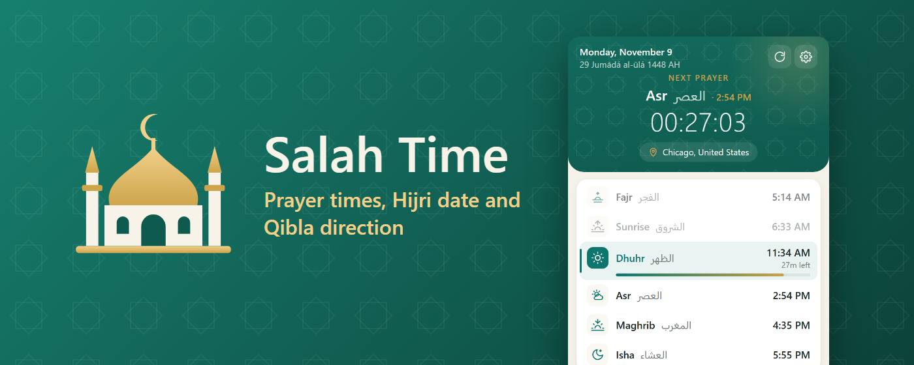
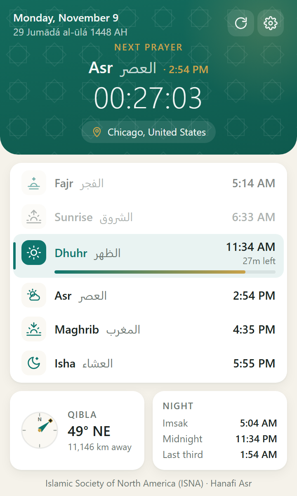
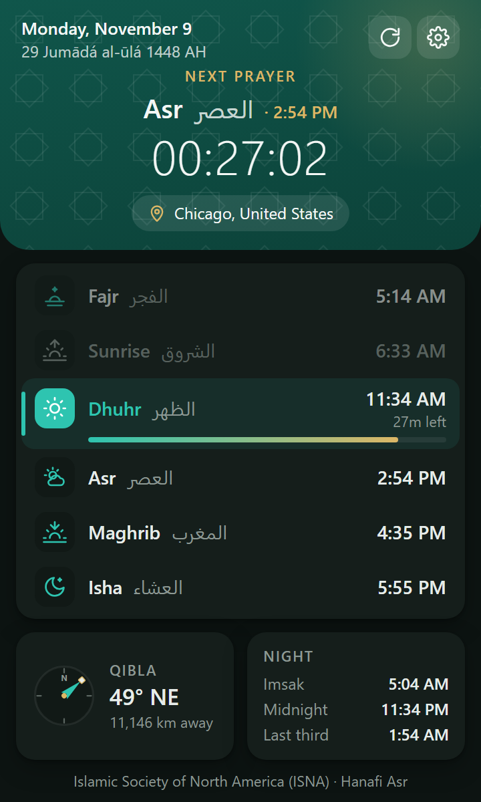
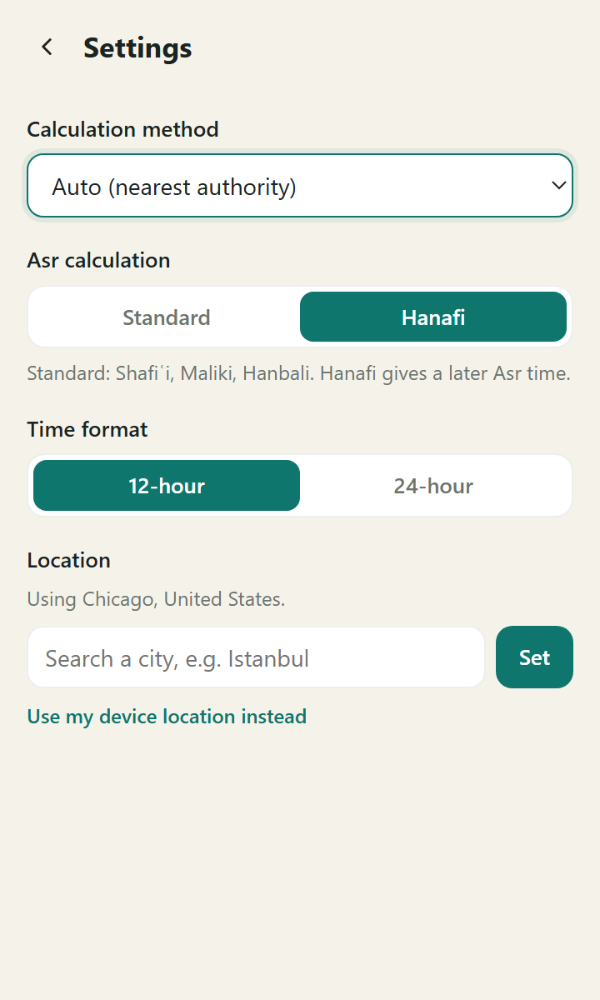

  

<h1 align="center">Salah Time</h1>

  A browser extension for Chrome and Firefox that shows today's Muslim prayer times in one click, with a live countdown to the next prayer.

## Screenshots

| Light theme | Dark theme | Settings |
| :---: | :---: | :---: |
|  |  |  |

## Features

- **Live countdown** to the next prayer, with a progress bar for the current one.
- **Today's times** for Fajr, Sunrise, Dhuhr (Jumuʿah on Fridays), Asr, Maghrib and Isha, with Arabic names.
- **Gregorian and Hijri dates.**
- **Qibla direction** and distance to Makkah.
- **Night times:** Imsak, Islamic midnight and the last third of the night.
- **Your location or any city:** detect your location automatically, or search for a city. Times and the countdown follow that city's own clock.
- **Settings:** 23 calculation methods or automatic selection, Standard or Hanafi Asr, and a 12-hour or 24-hour clock.
- **Opens instantly:** your last location and today's times are saved in your browser.
- **Light and dark themes** that follow your system.

## Install from source

Clone or download this repository, then follow the steps for your browser.

### Chrome and other Chromium browsers

1. Open `chrome://extensions/`.
2. Turn on **Developer mode** in the top right corner.
3. Click **Load unpacked** and select this repository's folder.

### Firefox 142 or newer

1. Open `about:debugging#/runtime/this-firefox`.
2. Click **Load Temporary Add-on...** and select `manifest.json` in this repository.

Temporary add-ons are removed when Firefox restarts.

## Usage

1. Click the Salah Time icon in your browser toolbar. You may need to pin it first.
2. Allow location access when asked, or open Settings and search for your city.

## Privacy

Salah Time has no account or ads. Your settings, last location and today's times are saved in your browser. To provide prayer times and place names, your location is sent to AlAdhan and OpenStreetMap Nominatim. Read the full [privacy policy](PRIVACY_POLICY.md).

## Built with

- HTML, CSS and JavaScript, with no build step
- [AlAdhan API](https://aladhan.com/prayer-times-api) for prayer times and Hijri dates
- [OpenStreetMap Nominatim](https://nominatim.org/) for place names and city search

## Contributing

Contributions are welcome:

1. Fork this repository.
2. Create a branch: `git checkout -b feature/YourFeature`.
3. Commit your changes: `git commit -m "Add some feature"`.
4. Push the branch: `git push origin feature/YourFeature`.
5. Open a pull request.

Please follow the existing code style and add comments where they help.

## License

This project is licensed under the [MIT License](LICENSE).
